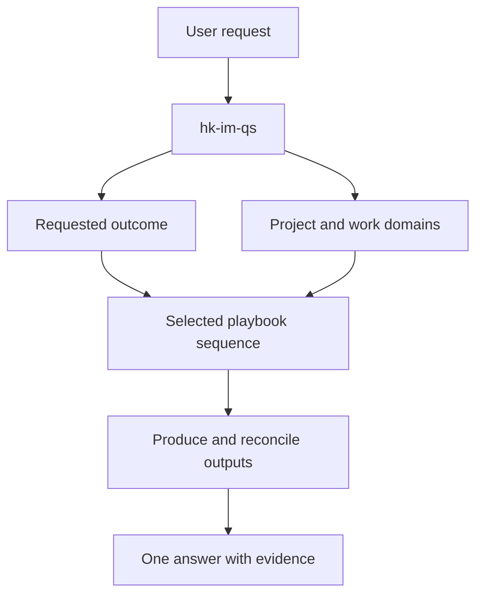

# Hong Kong I&M Quantity Surveying

**One entry skill. Describe the result you need; `hk-im-qs` selects and runs the relevant playbooks.**

Use it for **instrumentation and monitoring (I&M), ground investigation involving instruments, and ground improvement involving instruments** in Hong Kong. It handles tender reviews, measurements, estimates, payment valuations, changes and sourced document questions through one coordinated workflow.

[繁體中文說明](README.zh-HK.md) · [Entry skill](skills/hk-im-qs/SKILL.md) · [Router design](docs/ROUTER-DESIGN.md) · [Upgrade an existing installation](docs/MIGRATION.md)

## Start with the task

For a host that exposes skills as slash commands:

```text
/hk-im-qs Review this I&M tender and compare the two ADMS quotations.
Show missing scope, comparable costs and the RFIs in Traditional Chinese.
```

Attach or explicitly select `hk-im-qs` using your host's supported skill mechanism. The skill also describes natural-language triggers, but automatic discovery and invocation depend on the host. No pstack installation or specific model is required.

You do not choose or install a separate skill for each workstream. The router identifies the requested outcome, reads the appropriate internal playbook, loads the necessary domain references and delivers one checked answer. Internal playbooks have no separate slash commands.

## How routing works

The design follows the routing pattern of [Lauren Tan's pstack poteto-mode](https://github.com/cursor/plugins/blob/1ba91fc25c0977741dd0e267849e6234b037ed0a/pstack/skills/poteto-mode/SKILL.md): select the workflow, track its steps, load supporting material when needed and verify the actual result. The QS instructions and playbooks are written for this package. [Design and provenance](docs/ROUTER-DESIGN.md) explains the adaptations.

Two decisions work together:

1. **What result does the user need?** This selects the playbook.
2. **Which works are involved?** This selects I&M, GI and/or ground-improvement references.



| Requested outcome | Internal playbook | Main result |
|---|---|---|
| Review tender/quotation scope or compliance | [Review tender](skills/hk-im-qs/playbooks/review-tender.md) | Scope and responsibility matrix, coverage findings and RFIs |
| Measure records/drawings or prepare a BOQ | [Measure quantities](skills/hk-im-qs/playbooks/measure-quantities.md) | Traceable quantity ledger and proposed bill items |
| Build rates, price a package or compare quotations | [Estimate and compare quotations](skills/hk-im-qs/playbooks/estimate-and-compare-quotes.md) | Resource build-ups, comparable scope/costs and explicit gaps |
| Prepare a monthly valuation/payment reconciliation | [Value progress](skills/hk-im-qs/playbooks/value-progress.md) | Cumulative valuation, current amount and separate cash reconciliation |
| Assess extra work, changed frequency or an extension | [Assess change](skills/hk-im-qs/playbooks/assess-change.md) | Baseline-to-change assessment, quantity/cost delta and evidence position |
| Explain a requirement, inclusion, clause or edition | [Explain documents](skills/hk-im-qs/playbooks/explain-documents.md) | A sourced answer at the requested depth |

A monthly valuation for ground improvement therefore follows **value-progress**, with ground-improvement and I&M references. A question about whether instrument installation includes readings follows **explain-documents**. A budget for two extra monitoring months follows **estimating**; a question about claiming them follows **assess-change**.

For a combined task, the router composes the necessary steps and reuses one project basis, quantity ledger and coverage matrix. It asks only for missing facts that materially change the result. Independent checks can be delegated when useful and supported; a single agent can execute the same playbooks.

## What the single skill contains

- One discoverable `SKILL.md` in `skills/hk-im-qs/`.
- Six internal playbooks, each with inputs, ordered steps, outputs and completion checks.
- Three domain references for I&M, instrumented GI and instrumented ground improvement.
- Shared project/evidence controls, valuation rules, source notes and output templates.
- A register of **18 official Hong Kong reference sources**, with edition, URL, evidence level and applicability limits.

The three package modes remain `I&M_ONLY`, `GI_WITH_I&M` and `GROUND_IMPROVEMENT_WITH_I&M`. A task can cover several packages, each with its own adopted measurement and contract basis.

This is a QS workflow toolkit. Instrument locations, technical performance, trigger/action levels, treatment parameters, acceptance and permission to resume work remain with the responsible engineer. Outputs distinguish `CALCULATION_ONLY`, `NEEDS_SOURCE` and `READY_FOR_QS_REVIEW` at the affected row or conclusion.

## Hong Kong document basis

The [source register](skills/hk-im-qs/references/source-register.json), checked on **29 October 2026**, includes:

| Purpose | Principal reference route |
|---|---|
| Measurement and inclusive payment coverage | CEDD Standard Method of Measurement for Civil Engineering Works, 1992 Edition, with adopted corrigenda and particular preambles |
| GI, grouting and instrumentation technical scope | CEDD General Specification for Civil Engineering Works, 2020 Edition, Volume 1 Section 7 Parts 2, 4 and 6, with the adopted amendments |
| Investigation and ground descriptions | GEO Geoguide 2 and Geoguide 3, 2017 consolidated versions |
| Survey monitoring | Engineering Survey Practice Guides for Works Projects, August 2025 update, Chapter 7 |
| Geotechnical monitoring/control | GEO Publication 1/2023, TGN54 and project-approved I&M documents |
| Treatment verification and relevant marine work | TGN18 and applicable Port Works Design Manual Parts 3/4 |
| Contract/payment administration | Actual GCC/NEC/bespoke subcontract documents and relevant PAH/statutory provisions |

Use the edition incorporated into the project and retrieve the actual relevant clauses. The register distinguishes reviewed passages from verified publication metadata; it is not a claim that every source was read in full. Source books and private project records are not distributed here. See [source handling](docs/README.md).

## Install one skill

Clone the repository, then give the installer your host's actual user/project skills directory. Python 3 is required for the installer and validator only.

```bash
git clone https://github.com/Kylefan725/qs-skills-hk.git
cd qs-skills-hk

# Replace this example target with the directory supported by your host.
python3 scripts/install_skills.py --target /path/to/your/skills --dry-run
python3 scripts/install_skills.py --target /path/to/your/skills --mode copy
```

Copy mode places the complete self-contained `hk-im-qs` folder under that target. Symlink mode is available with `--mode symlink`; keep this checkout at its original location and pull updates there. Neither mode overwrites an existing destination or unrelated skills.

**Upgrading from v0.2.0 or v0.1.0:** archive the previous `hkqs-mode` entry or the original seven entry skills outside your active skills directory, then install `hk-im-qs`. The installer detects all legacy names, including broken symlinks, and stops before writing. Follow the [migration instructions](docs/MIGRATION.md) to preserve local changes. This repository has not installed anything into your personal Skills directory automatically.

## Example requests

```text
/hk-im-qs Check the drilled lengths and piezometer installations in these logs.
Show raw quantities, proposed payable quantities and any inclusive-rate overlap.

/hk-im-qs Prepare this month's ground-improvement valuation and assess the
additional monitoring period. Keep unsupported entitlement and unpaid cash separate.

/hk-im-qs Does this adopted instrument-installation item include readings?
Explain the clause and the effect of this particular preamble only.

/hk-im-qs 比較這兩份 ADMS 報價，按相同監測點數、工期、維修及報告要求比較，
並列出未有報價或定義不清的項目。
```

## Validate and maintain

```bash
python3 scripts/validate_repository.py
python3 -m unittest discover -s tests -v
```

The validator checks one skill entry, six playbooks, source metadata and local/self-contained links. Tests cover installation and migration conflicts. These do not prove an LLM will always route correctly or replace a professional review; practical routing checks and their limits are recorded in [VALIDATION.md](docs/VALIDATION.md).

Adapted from [kuikiun/qs-skills](https://github.com/kuikiun/qs-skills), with the original [MIT notice](LICENSE) retained. **Version `0.3.0-hk-im`** names the single entry `hk-im-qs` to make its Hong Kong I&M quantity-surveying scope explicit.
